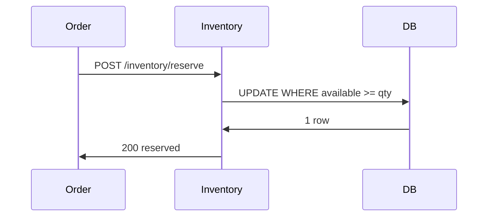

# 15. Inventory service

**Category:** Spring Boot microservices  |  **Status:** Scaffold - implement the TODOs

Atomic conditional reserve, 409 when short, release as compensation.

## Sequence


## Run
```bash
docker compose up -d
mvn spring-boot:run
```

## Part of
[system-design-concepts-master](../../README.md) - see the master repo for the full concept map.
